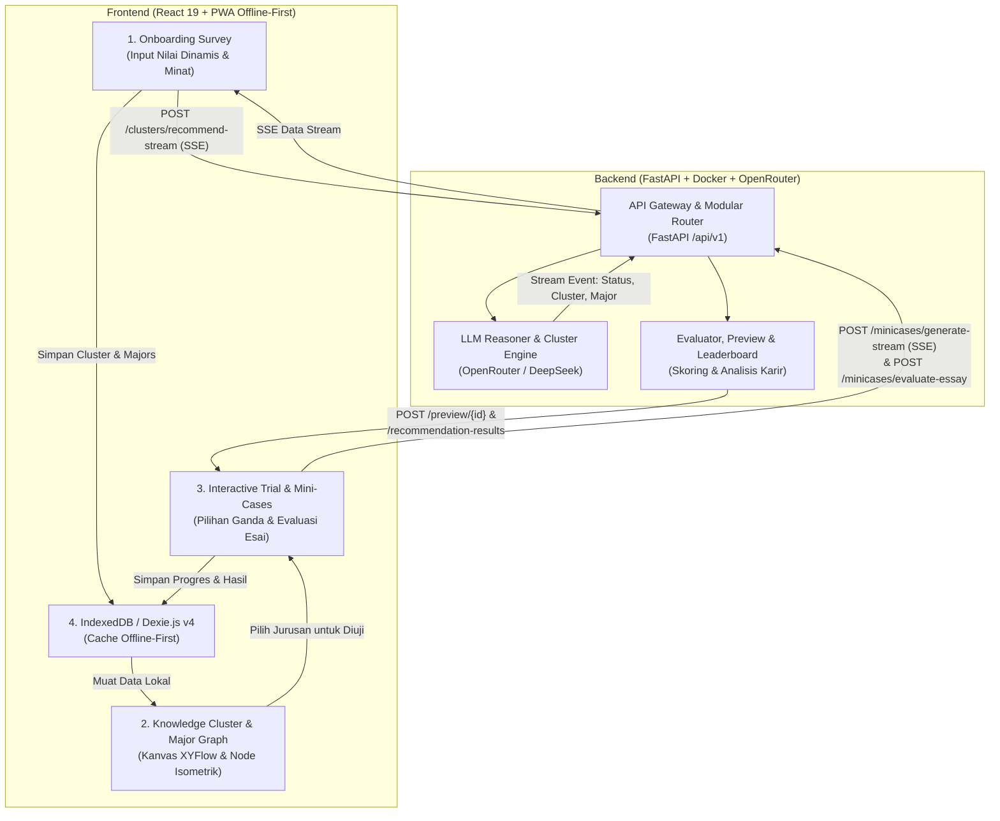

# 🧭 ArahKita — Monorepo

> **Platform Bimbingan & Rekomendasi Jurusan Berbasis AI & Visual Interaktif untuk Siswa SMA/SMK.**

ArahKita dirancang untuk menjawab permasalahan siswa SMA/SMK kelas akhir yang mengalami kebingungan dalam menentukan jurusan kuliah dan jalur karir. Menggabungkan arsitektur **Progressive Web App (PWA) Offline-First** dengan penalaran cerdas **LLM (Large Language Model)**, ArahKita menyajikan pengelompokan rumpun keilmuan (_knowledge clusters_), peta pohon interaktif bertingkat (_learning graph_), dan uji diagnostik mini-case (_interactive trial_) yang mendalam.

---

## 📌 Daftar Isi

- [🧭 ArahKita — Monorepo](#-arahkita--monorepo)
  - [📌 Daftar Isi](#-daftar-isi)
  - [🔄 Arsitektur \& Alur Sistem](#-arsitektur--alur-sistem)
    - [Penjelasan Alur:](#penjelasan-alur)
  - [📂 Struktur Monorepo](#-struktur-monorepo)
  - [⚙️ Prasyarat Sistem](#️-prasyarat-sistem)
  - [🚀 Panduan Menjalankan Aplikasi](#-panduan-menjalankan-aplikasi)
    - [Langkah 1: Menjalankan Backend (Docker)](#langkah-1-menjalankan-backend-docker)
    - [Langkah 2: Menjalankan Frontend (Vite)](#langkah-2-menjalankan-frontend-vite)
    - [Opsi Alternatif: Backend Tanpa Docker (uv)](#opsi-alternatif-backend-tanpa-docker-uv)
  - [📡 Ringkasan Endpoint REST API](#-ringkasan-endpoint-rest-api)
  - [🌐 Tautan Layanan \& Verifikasi](#-tautan-layanan--verifikasi)
  - [🛠️ Teknologi yang Digunakan](#️-teknologi-yang-digunakan)
    - [Frontend (`arahkita-frontend`)](#frontend-arahkita-frontend)
    - [Backend (`arahkita-backend`)](#backend-arahkita-backend)
  - [📖 Dokumentasi Lanjutan](#-dokumentasi-lanjutan)

---

## 🔄 Arsitektur & Alur Sistem

ArahKita memisahkan beban kerja antara antarmuka visual yang responsif (_client-side_) dengan orkestrasi model bahasa (_server-side_).



### Penjelasan Alur:

1. **Onboarding Survey**: Pengguna mengisi 3 hingga 10 nilai mata pelajaran (skor 0–100) dan memilih kategori minat (kombinasi gelembung visual dan input manual).
2. **Generasi Rumpun Keilmuan & Rekomendasi Jurusan (LLM + SSE)**: Frontend mengalirkan data ke `POST /api/v1/clusters/recommend-stream`. Backend secara asinkron men-generate 5 jurusan potensial dan mengelompokkannya ke dalam rumpun keilmuan (`KnowledgeCluster` & `MajorNode`), disertai umpan status progres berpikir AI secara real-time.
3. **Penyimpanan Offline-First & Graph Navigasi**: Rumpun keilmuan dan jurusan disimpan ke IndexedDB lokal via Dexie.js (skema v4). Pengguna mengeksplorasi graf interaktif bertingkat (XYFlow) dengan platform visual silinder 3D isometrik dan relasi graf hierarkis.
4. **Interactive Trial (Mini-cases Streaming)**: Untuk menguji kecocokan secara riil, siswa memilih jurusan dan mengerjakan 6–10 node simulasi studi kasus. Soal dialirkan via SSE (`POST /api/v1/minicases/generate-stream`) dan disimpan bertahap ke IndexedDB. Jawaban esai dievaluasi langsung oleh AI (`POST /api/v1/minicases/evaluate-essay`).
5. **Pratinjau Jurusan & Leaderboard Rekomendasi**:
   - Rangkuman jurusan, persentase kecocokan terbobot, dan rekomendasi karir riil disintesis melalui `POST /api/v1/preview/{major_node_id}`.
   - Peringkat akhir seluruh jurusan disusun secara dinamis pada halaman evaluasi melalui `POST /api/v1/recommendation-results`.

---

## 📂 Struktur Monorepo

```text
arahkita/
├── README.md                   # Dokumentasi monorepo utama (berkas ini)
├── .gitignore                  # Konfigurasi ignore git monorepo
├── arahkita-backend/           # Layanan Backend (FastAPI, Python 3.12, Docker, uv)
│   ├── Dockerfile              # Konfigurasi container image berbasis Python 3.12-slim & uv
│   ├── docker-compose.yaml     # Orkestrasi container backend lokal
│   ├── pyproject.toml          # Definisi proyek & dependensi Python
│   ├── uv.lock                 # Lockfile dependensi deterministik
│   ├── AGENTS.md               # Panduan teknis, standar arsitektur & coding backend
│   ├── README.md               # Panduan backend lokal & deployment Cloudflare Tunnel
│   ├── tests/                  # Automated test suite (Pytest: cluster, minicase, preview, dsb.)
│   └── src/arahkita_backend/   # Kode sumber modul backend FastAPI
│       ├── api/v1/             # Modular routers (clusters, majors, minicases, preview, results)
│       ├── adapters/openrouter/# Client OpenRouter LLM modular, parser, & system prompts
│       ├── schemas/            # Skema validasi Pydantic v2 (I/O kontrak API & structured output)
│       ├── services/           # Logika bisnis, clustering keilmuan, & SSE stream generator
│       ├── config/             # Immutable configuration settings (@dataclass(frozen=True))
│       └── utils/              # Palet warna, generator UUID v4, & parsing utilitas
└── arahkita-frontend/          # Layanan Frontend (React 19, Vite, Tailwind CSS v4, PWA)
    ├── package.json            # Dependensi JavaScript & skrip build
    ├── vite.config.js          # Konfigurasi Vite & vite-plugin-pwa
    ├── index.html              # Entry HTML web app
    ├── vercel.json             # Konfigurasi rewrite SPA deployment Vercel
    ├── AGENTS.md               # Panduan teknis arsitektur offline-first & standar React 19
    ├── README.md               # Dokumentasi frontend aplikasi web
    └── src/                    # Kode sumber antarmuka pengguna
        ├── api/                # Integrasi REST API & listener Server-Sent Events (SSE)
        ├── repositories/       # Abstraksi IndexedDB lokal (Dexie.js v4)
        ├── components/         # Komponen UI modular (PlatformNode, GraphNode, Splash, Test, dsb.)
        ├── pages/              # Halaman alur aplikasi (Splash, Graph, Rekomendasi, Test, Profil)
        ├── utils/              # Pemetaan klaster rumpun, subject normalizer, layout slot graf
        └── lib/                # Singleton Axios client & inisialisasi skema Dexie
```

---

## ⚙️ Prasyarat Sistem

Sebelum menjalankan aplikasi, pastikan sistem Anda telah terpasang:

- **Docker** dan **Docker Compose** (untuk menjalankan backend dengan mudah).
- **Node.js** `>= 18.0.0` dan **npm** (untuk menjalankan frontend).
- _(Opsional)_ **Python** `>= 3.12` dan [`uv`](https://docs.astral.sh/uv/) (hanya jika ingin menjalankan backend tanpa Docker).
- **Koneksi Internet** & **API Key OpenRouter** (untuk penalaran LLM).

---

## 🚀 Panduan Menjalankan Aplikasi

Jalankan backend terlebih dahulu agar endpoint API siap menerima panggilan dari frontend.

### Langkah 1: Menjalankan Backend (Docker)

Backend telah dilengkapi dengan konfigurasi Docker Compose berbasis Python 3.12-slim dan paket `uv` berkinerja tinggi.

1. **Masuk ke folder backend**:

   ```bash
   cd arahkita-backend
   ```

2. **Buat berkas `.env` dari contoh**:

   ```bash
   cp .env.example .env
   ```

3. **Sesuaikan kredensial di dalam `.env`**:
   Buka berkas `.env` dan masukkan API Key OpenRouter Anda:

   ```env
   OPENROUTER_API_KEY=sk-or-v1-xxxxxxxxxxxxxxxxxxxx
   OPENROUTER_MODEL=deepseek/deepseek-v4-flash-0731
   OPENROUTER_BASE_URL=https://openrouter.ai/api/v1
   APP_HOST=0.0.0.0
   APP_PORT=8000
   ```

4. **Jalankan container backend**:

   ```bash
   docker compose up -d --build
   ```

5. **Periksa status dan log container**:
   ```bash
   docker compose logs -f
   ```
   _(Tekan `Ctrl+C` untuk keluar dari pemantauan log)._

---

### Langkah 2: Menjalankan Frontend (Vite)

Buka terminal baru di direktori root monorepo:

1. **Masuk ke folder frontend**:

   ```bash
   cd arahkita-frontend
   ```

2. **Siapkan konfigurasi environment**:
   Buat file `.env` (atau pastikan sudah tersedia):

   ```bash
   cp .env.example .env
   ```

   Pastikan mengarah ke backend lokal yang sedang berjalan:

   ```env
   VITE_API_BASE_URL=http://localhost:8000
   ```

3. **Install dependensi Node.js**:

   ```bash
   npm install
   ```

4. **Jalankan Vite Development Server**:

   ```bash
   npm run dev
   ```

5. Buka peramban (browser) di alamat yang muncul di terminal (biasanya **`http://localhost:5173`**).

---

### Opsi Alternatif: Backend Tanpa Docker (uv)

Jika ingin menjalankan backend secara langsung di lingkungan host menggunakan Python:

```bash
cd arahkita-backend

# 1. Pastikan file .env sudah dikonfigurasi
cp .env.example .env

# 2. Sinkronisasi dependensi virtualenv
uv sync

# 3. Jalankan server FastAPI dengan auto-reload
uv run python -m arahkita_backend
```

Server backend akan aktif di `http://localhost:8000`.

---

## 🌐 Tautan Layanan & Verifikasi

Setelah kedua servis berjalan:

| Layanan                    | Alamat URL Lokal               | Alamat URL Produksi / Cloud           | Keterangan                         |
| -------------------------- | ------------------------------ | ------------------------------------- | ---------------------------------- |
| **Frontend PWA**           | `http://localhost:5173`        | Sesuai URL deployment Vercel          | Antarmuka interaktif pengguna      |
| **Backend Health Check**   | `http://localhost:8000/health` | `https://api.nyomanyogi.my.id/health` | Status kesehatan API               |
| **Interactive Swagger UI** | `http://localhost:8000/docs`   | `https://api.nyomanyogi.my.id/docs`   | Dokumentasi interaktif Swagger API |
| **ReDoc Documentation**    | `http://localhost:8000/redoc`  | `https://api.nyomanyogi.my.id/redoc`  | Dokumentasi alternatif ReDoc API   |

---

## 🛠️ Teknologi yang Digunakan

### Frontend (`arahkita-frontend`)

- **React 19**: UI rendering berperforma tinggi dengan hooks modern.
- **Vite 8**: Build tool modern dengan HMR (_Hot Module Replacement_) instan.
- **Tailwind CSS v4**: Utility-first CSS engine modern.
- **@xyflow/react v12**: Render kanvas dan simpul graf (_interactive graph nodes_) dengan node silinder 3D isometrik dan garis tepi kustom (_animated edge_).
- **Dexie.js v4 (IndexedDB)**: Database lokal di browser untuk kapabilitas _offline-first_ penuh (tabel `clusters`, `majorNodes`, `minicases`, `previews`, `recommendationResults`, `userProfile`).
- **Server-Sent Events (SSE)**: Penerimaan stream data dan indikator progres AI secara asinkron tanpa _polling_.
- **vite-plugin-pwa**: Dukungan instalasi PWA di Android, iOS, dan Desktop dengan Service Worker dan offline cache.
- **Axios**: HTTP client dengan penanganan error, abort controller, dan timeout terpusat.
- **Lottie React**: Animasi vektor interaktif untuk onboarding dan loading state.

### Backend (`arahkita-backend`)

- **Python 3.12**: Runtime bahasa pemrograman dengan type hint modern.
- **FastAPI**: Web framework asynchronous berbasis ASGI berkinerja tinggi.
- **Pydantic v2**: Validasi ketat skema request, response, dan structured output LLM.
- **uv**: Package manager Python berbasis Rust yang cepat dan deterministik via `uv.lock`.
- **OpenRouter SDK / AsyncOpenAI**: Integrasi multi-LLM (`deepseek/deepseek-v4-flash-0731`) dengan prompt engineering modular.
- **Server-Sent Events (SSE)**: Streaming responses via FastAPI `StreamingResponse` untuk pengalaman pengguna interaktif.
- **Docker & Docker Compose**: Kontainerisasi aplikasi untuk kemudahan deployment lokal maupun server.
- **Cloudflare Tunnel**: Dukungan eksposur tunneling publik aman via HTTPS tanpa port-forwarding.

---

## 📖 Dokumentasi Lanjutan

Untuk pengembang dan AI coding assistant yang membutuhkan konteks teknis mendalam:

- **[arahkita-backend/AGENTS.md](arahkita-backend/AGENTS.md)**: Standar Python strict (Pyright), pola dependency injection, skema validasi Pydantic v2, serta struktur prompt LLM.
- **[arahkita-backend/README.md](arahkita-backend/README.md)**: Panduan konfigurasi backend dan setup deployment Cloudflare Tunnel 24/7 di Ubuntu Server.
- **[arahkita-frontend/AGENTS.md](arahkita-frontend/AGENTS.md)**: Standar ESLint React 19, arsitektur offline-first Dexie v4, dan pedoman styling Tailwind CSS v4.
- **[arahkita-frontend/README.md](arahkita-frontend/README.md)**: Dokumentasi fitur frontend, struktur direktori antarmuka, dan panduan build produksi.
