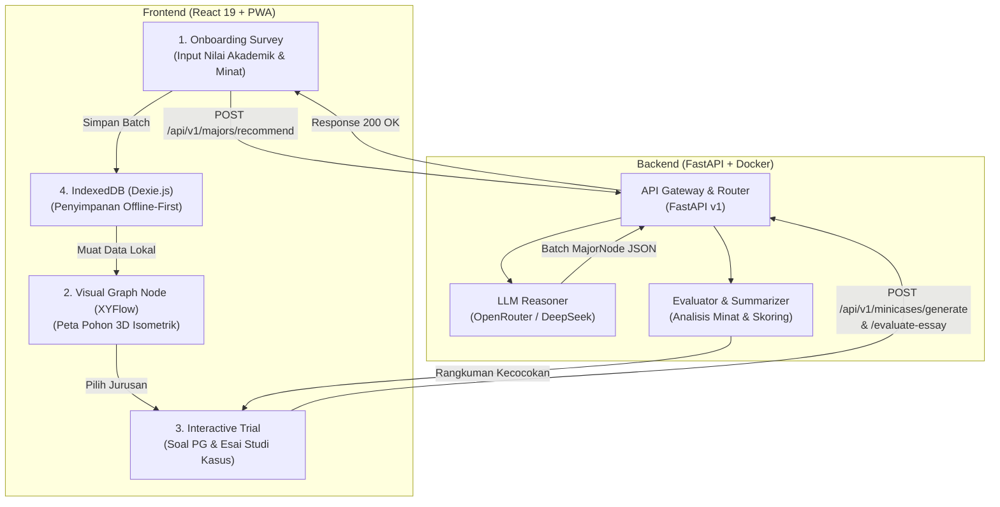

# 🧭 ArahKita — Monorepo

> **Platform Bimbingan & Rekomendasi Jurusan Berbasis AI & Visual Interaktif untuk Siswa SMA/SMK.**

ArahKita dirancang untuk menjawab permasalahan siswa SMA/SMK kelas akhir yang mengalami kebingungan dalam menentukan jurusan kuliah dan jalur karir. Menggabungkan arsitektur **Progressive Web App (PWA) Offline-First** dengan penalaran cerdas **LLM (Large Language Model)**, ArahKita menyajikan peta pohon interaktif bertingkat (*learning graph*) dan uji diagnostik mini-case (*interactive trial*) yang mendalam.

---

## 📌 Daftar Isi
- [🧭 ArahKita — Monorepo](#-arahkita--monorepo)
  - [📌 Daftar Isi](#-daftar-isi)
  - [🔄 Arsitektur \& Alur Sistem](#-arsitektur--alur-sistem)
    - [Penjelasan Alur:](#penjelasan-alur)
  - [📂 Struktur Monorepo](#-struktur-monorepo)
  - [⚙️ Prasyarat Sistem](#️-prasyarat-sistem)
  - [🚀 Panduan Menjalankan Aplikasi](#-panduan-menjalankan-aplikasi)
    - [Langkah 1: Menjalankan Backend (Docker)](#langkah-1-menjalankan-backend-docker)
    - [Langkah 2: Menjalankan Frontend (Vite)](#langkah-2-menjalankan-frontend-vite)
    - [Opsi Alternatif: Backend Tanpa Docker (uv)](#opsi-alternatif-backend-tanpa-docker-uv)
  - [🌐 Tautan Layanan \& Verifikasi](#-tautan-layanan--verifikasi)
  - [🛠️ Teknologi yang Digunakan](#️-teknologi-yang-digunakan)
    - [Frontend (`arahKita-mvp`)](#frontend-arahkita-mvp)
    - [Backend (`arahkita-backend`)](#backend-arahkita-backend)
  - [📖 Dokumentasi Lanjutan](#-dokumentasi-lanjutan)

---

## 🔄 Arsitektur & Alur Sistem

ArahKita memisahkan beban kerja antara antarmuka visual yang responsif (*client-side*) dengan orkestrasi model bahasa (*server-side*).



### Penjelasan Alur:
1. **Onboarding Survey**: Pengguna mengisi 3 hingga 10 nilai mata pelajaran (skor 0–100) dan memilih kategori minat (kombinasi gelembung visual dan input manual).
2. **Generasi Rekomendasi Jurusan (LLM)**: Frontend menormalisasi payload dan mengirimkannya ke endpoint `POST /api/v1/majors/recommend`. Backend memproses data tersebut menggunakan model LLM untuk menghasilkan 2–6 rekomendasi jurusan (`MajorNode`) yang dilengkapi palet warna dan profil.
3. **Penyimpanan Offline-First & Graph Navigasi**: Rekomendasi disimpan ke IndexedDB lokal via Dexie.js. Pengguna diarahkan ke kanvas graf interaktif bertingkat (XYFlow) dengan platform visual 3D isometrik.
4. **Interactive Trial (Mini-cases)**: Untuk menguji kecocokan secara riil, siswa mengerjakan simulasi studi kasus mini (pilihan ganda dan esai) yang dihasilkan dan dinilai oleh backend.
5. **Rangkuman Keminatan Komprehensif**: Setelah tes selesai, backend menyusun ringkasan kecocokan dan rekomendasi langkah karir nyata.

---

## 📂 Struktur Monorepo

```text
arahkita/
├── README.md               # Dokumentasi monorepo utama (berkas ini)
├── arahkita-backend/       # Servis Backend (FastAPI, Python 3.12, Docker)
│   ├── Dockerfile
│   ├── docker-compose.yaml
│   ├── pyproject.toml
│   ├── uv.lock
│   ├── AGENTS.md           # Panduan teknis & standar coding backend
│   ├── api_docs.md         # Kontrak & dokumentasi lengkap REST API
│   └── src/                # Kode sumber FastAPI
└── arahKita-mvp/           # Servis Frontend (React 19, Vite, Tailwind CSS v4, PWA)
    ├── package.json
    ├── vite.config.js
    ├── index.html
    ├── AGENTS.md           # Panduan teknis & arsitektur frontend
    └── src/                # Komponen UI, pages, state, & Dexie DB
```

---

## ⚙️ Prasyarat Sistem

Sebelum menjalankan aplikasi, pastikan sistem Anda telah terpasang:
- **Docker** dan **Docker Compose** (untuk menjalankan backend).
- **Node.js** `>= 18.0.0` dan **npm** (untuk menjalankan frontend).
- *(Opsional)* **Python** `>= 3.12` dan [`uv`](https://docs.astral.sh/uv/) (hanya jika ingin menjalankan backend tanpa Docker).
- **Koneksi Internet** & **API Key OpenRouter** (untuk fitur generasi AI).

---

## 🚀 Panduan Menjalankan Aplikasi

Jalankan backend terlebih dahulu agar endpoint API siap menerima panggilan dari frontend.

### Langkah 1: Menjalankan Backend (Docker)

Backend telah dilengkapi dengan konfigurasi Docker Compose berbasis Python 3.12-slim dan paket `uv` berkinerja tinggi.

1. **Masuk ke folder backend**:
   ```bash
   cd arahkita-backend
   ```

2. **Buat berkas `.env` dari contoh**:
   ```bash
   cp .env.example .env
   ```

3. **Sesuaikan kredensial di dalam `.env`**:
   Buka berkas `.env` dan masukkan API Key OpenRouter Anda:
   ```env
   OPENROUTER_API_KEY=sk-or-v1-xxxxxxxxxxxxxxxxxxxx
   OPENROUTER_MODEL=deepseek/deepseek-v4-flash-0731
   OPENROUTER_BASE_URL=https://openrouter.ai/api/v1
   APP_HOST=0.0.0.0
   APP_PORT=8000
   ```

4. **Jalankan container backend**:
   ```bash
   docker compose up -d --build
   ```

5. **Periksa status dan log container**:
   ```bash
   docker compose logs -f
   ```
   *(Tekan `Ctrl+C` untuk keluar dari pemantauan log).*

---

### Langkah 2: Menjalankan Frontend (Vite)

Buka terminal baru di direktori root monorepo:

1. **Masuk ke folder frontend**:
   ```bash
   cd arahKita-mvp
   ```

2. **Siapkan konfigurasi environment**:
   Buat file `.env` (atau pastikan sudah tersedia):
   ```bash
   cp .env.example .env
   ```
   Pastikan mengarah ke backend lokal yang sedang berjalan:
   ```env
   VITE_API_BASE_URL=http://localhost:8000/api/v1
   ```

3. **Install dependensi Node.js**:
   ```bash
   npm install
   ```

4. **Jalankan Vite Development Server**:
   ```bash
   npm run dev
   ```

5. Buka peramban (browser) di alamat yang muncul di terminal (biasanya **`http://localhost:5173`**).

---

### Opsi Alternatif: Backend Tanpa Docker (uv)

Jika ingin menjalankan backend secara langsung di lingkungan host menggunakan Python:

```bash
cd arahkita-backend

# 1. Pastikan file .env sudah dikonfigurasi
cp .env.example .env

# 2. Sinkronisasi dependensi virtualenv
uv sync

# 3. Jalankan server FastAPI dengan auto-reload
uv run python -m arahkita_backend
```
Server backend akan aktif di `http://localhost:8000`.

---

## 🌐 Tautan Layanan & Verifikasi

Setelah kedua servis berjalan:

| Layanan | Alamat URL | Keterangan |
|---|---|---|
| **Frontend PWA** | `http://localhost:5173` | Antarmuka interaktif pengguna |
| **Backend Health Check** | `http://localhost:8000/health` | Status kesehatan API (`{"status":"ok"}`) |
| **Interactive Swagger UI** | `http://localhost:8000/docs` | Dokumentasi interaktif Swagger API |
| **ReDoc Documentation** | `http://localhost:8000/redoc` | Dokumentasi alternatif ReDoc API |

---

## 🛠️ Teknologi yang Digunakan

### Frontend (`arahKita-mvp`)
- **React 19**: UI rendering berperforma tinggi dengan hooks modern.
- **Vite 8**: Build tool modern dengan HMR (*Hot Module Replacement*) instan.
- **Tailwind CSS v4**: Utility-first CSS engine terbaru.
- **@xyflow/react v12**: Render kanvas dan simpul graf (*interactive graph nodes*).
- **Dexie.js v4 (IndexedDB)**: Database lokal di browser untuk kapabilitas *offline-first*.
- **vite-plugin-pwa**: Dukungan instalasi PWA di Android, iOS, dan Desktop dengan Service Worker.
- **Axios**: HTTP client dengan penanganan error dan fallback data terpusat.
- **Lottie React**: Animasi vektor interaktif.

### Backend (`arahkita-backend`)
- **Python 3.12**: Runtime bahasa pemrograman dengan type hint modern.
- **FastAPI**: Web framework asynchronous berbasis ASGI.
- **Pydantic v2**: Validasi ketat skema request, response, dan output LLM.
- **uv**: Package manager Python berbasis Rust yang cepat dan deterministik.
- **OpenRouter SDK / AsyncOpenAI**: Akses multi-LLM terstandar.
- **Docker & Docker Compose**: Kontainerisasi aplikasi untuk kemudahan deployment.

---

## 📖 Dokumentasi Lanjutan

Untuk pengembang dan AI coding assistant yang membutuhkan konteks teknis mendalam:
- **[arahkita-backend/AGENTS.md](arahkita-backend/AGENTS.md)**: Standar Python strict (Pyright), pola dependency injection, dan skema validasi Pydantic.
- **[arahkita-backend/api_docs.md](arahkita-backend/api_docs.md)**: Spesifikasi rinci setiap endpoint, contoh payload request/response, dan penanganan error.
- **[arahKita-mvp/AGENTS.md](arahKita-mvp/AGENTS.md)**: Standar ESLint React 19, arsitektur offline-first Dexie, dan pedoman styling Tailwind CSS v4.

