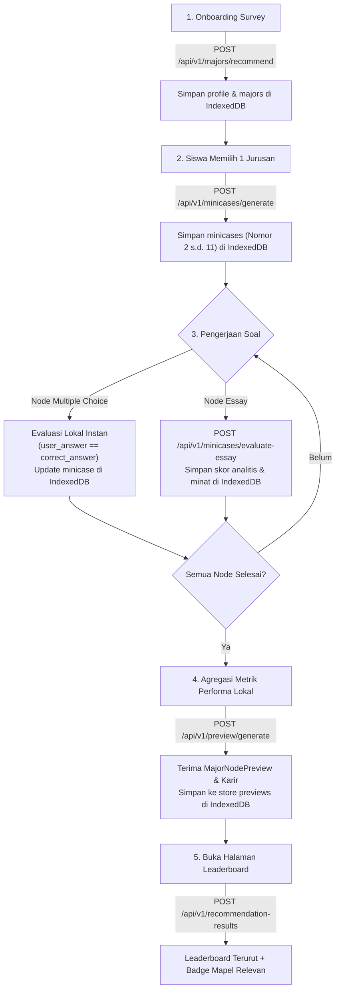

# 📦 Strategi Penyimpanan Progres & Sinkronisasi Backend (IndexedDB)

Dokumen ini menjelaskan strategi integrasi antara **Penyimpanan Lokal Frontend (IndexedDB)** dan **ArahKita Backend (Stateless AI Gateway)** untuk pencatatan progres, evaluasi berkala, agregasi metrik, dan penyusunan leaderboard akhir.

---

## 📌 Daftar Isi
1. [Arsitektur & Prinsip Utama](#1-arsitektur--prinsip-utama)
2. [Desain Skema Object Store IndexedDB (Dexie.js)](#2-desain-skema-object-store-indexeddb-dexiejs)
3. [Alur Siklus Hidup Pengerjaan & Sinkronisasi](#3-alur-siklus-hidup-pengerjaan--sinkronisasi)
4. [Contoh Kode Implementasi Frontend](#4-contoh-kode-implementasi-frontend)
   - [4.1. Setup Database Dexie (db.js)](#41-setup-database-dexie-dbjs)
   - [4.2. Penanganan Jawaban MCQ (Offline-First)](#42-penanganan-jawaban-mcq-offline-first)
   - [4.3. Penanganan Jawaban Esai (Real-time AI Scoring)](#43-penanganan-jawaban-esai-real-time-ai-scoring)
   - [4.4. Agregasi Metrik & Generate Preview](#44-agregasi-metrik--generate-preview)
   - [4.5. Pengiriman Data ke Leaderboard Akhir](#45-pengiriman-data-ke-leaderboard-akhir)
5. [Formula Kalkulasi Persentase Kecocokan Backend](#5-formula-kalkulasi-persentase-kecocokan-backend)

---

## 1. Arsitektur & Prinsip Utama

1. **Stateless Backend**:
   - Backend tidak menyimpan database pengguna atau state pengerjaan.
   - Bertindak murni sebagai **AI Gateway**: memproses NLP, psikometrik esai, sintesis narasi karir, dan kalkulasi peringkat.
2. **Offline-First Frontend**:
   - Seluruh status progres (`is_done`, pilihan jawaban, hasil penilaian AI sementara) disimpan di **IndexedDB browser**.
   - Pengguna dapat melanjutkan pengerjaan kapan saja tanpa kehilangan progres.

---

## 2. Desain Skema Object Store IndexedDB (Dexie.js)

Gunakan 4 Object Store utama pada IndexedDB:

| Object Store | Primary Key | Indeks Kunci | Kegunaan |
| :--- | :--- | :--- | :--- |
| `profile` | `++id` *(auto)* | - | Menyimpan input minat & nilai rapor awal siswa dari onboarding. |
| `majors` | `id` *(UUID)* | `major_name` | Menyimpan daftar rekomendasi jurusan (`MajorNode`). |
| `minicases` | `id` *(UUID)* | `parent_id, minicase_number, is_done, node_type` | Rantai soal studi kasus trial beserta jawaban & status pengerjaan. |
| `previews` | `id` *(UUID)* | `major_node_id, matching_percentage` | Rangkuman evaluasi komprehensif & jalur karir tiap jurusan. |

---

## 3. Alur Siklus Hidup Pengerjaan & Sinkronisasi



---

## 4. Contoh Kode Implementasi Frontend

### 4.1. Setup Database Dexie (`src/db/index.js`)

```javascript
import Dexie from 'dexie';

export const db = new Dexie('ArahKitaDB');

db.version(1).stores({
  profile: '++id',
  majors: 'id, major_name',
  minicases: 'id, parent_id, minicase_number, is_done, node_type',
  previews: 'id, major_node_id, matching_percentage',
});
```

---

### 4.2. Penanganan Jawaban MCQ (Offline-First)

Untuk soal pilihan ganda, kunci jawaban (`correct_answer`) sudah ada di objek `MinicaseNode`. Evaluasi dilakukan instan di sisi browser tanpa request jaringan:

```javascript
import { db } from '../db';

export async function submitMultipleChoiceAnswer(minicaseId, selectedOption) {
  const node = await db.minicases.get(minicaseId);
  if (!node) throw new Error('Node tidak ditemukan.');

  const isCorrect = selectedOption === node.correct_answer;

  await db.minicases.update(minicaseId, {
    user_answer: selectedOption,
    is_correct: isCorrect,
    is_done: true,
    updated_at: new Date().toISOString(),
  });

  return { isCorrect };
}
```

---

### 4.3. Penanganan Jawaban Esai (Real-time AI Scoring)

Kirim teks jawaban siswa ke backend untuk dinilai kualitas analitis dan sinyal minatnya:

```javascript
import { db } from '../db';

const BASE_URL = import.meta.env.VITE_API_BASE_URL || 'https://api.nyomanyogi.my.id/api/v1';

export async function submitEssayAnswer(node, userText) {
  // 1. Panggil Evaluator AI di Backend
  const response = await fetch(`${BASE_URL}/minicases/evaluate-essay`, {
    method: 'POST',
    headers: { 'Content-Type': 'application/json' },
    body: JSON.stringify({
      question: node.question,
      evaluation_hint: node.evaluation_hint,
      user_answer: userText.trim(),
      minicase_id: node.id,
    }),
  });

  if (!response.ok) {
    throw new Error('Gagal mengevaluasi esai.');
  }

  const evalResult = await response.json();
  // evalResult: { analytical_fit: 4, interest_signal: 5, is_serious_attempt: true }

  // 2. Simpan skor & status ke IndexedDB lokal
  await db.minicases.update(node.id, {
    user_answer: userText.trim(),
    analytical_fit: evalResult.analytical_fit,
    interest_signal: evalResult.interest_signal,
    is_serious_attempt: evalResult.is_serious_attempt,
    is_done: true,
    updated_at: new Date().toISOString(),
  });

  return evalResult;
}
```

---

### 4.4. Agregasi Metrik & Generate Preview

Saat seluruh trial di satu jurusan telah selesai, frontend menghitung metrik agregat dari IndexedDB lalu meminta backend men-generate narasi preview dan rekomendasi profesi:

```javascript
import { db } from '../db';

const BASE_URL = import.meta.env.VITE_API_BASE_URL || 'https://api.nyomanyogi.my.id/api/v1';

/**
 * Menghitung rekap performa trial dari IndexedDB.
 */
export async function calculateMajorMetrics(majorId) {
  const nodes = await db.minicases.where({ parent_id: majorId, is_done: true }).toArray();

  const mcqNodes = nodes.filter((n) => n.node_type === 'multiple_choice');
  const essayNodes = nodes.filter((n) => n.node_type === 'essay');

  // 1. Akurasi MCQ (0 - 100%)
  const correctCount = mcqNodes.filter((n) => n.is_correct === true).length;
  const mcqAccuracy = mcqNodes.length > 0 ? (correctCount / mcqNodes.length) * 100 : 0;

  // 2. Rata-rata Skor Kemampuan Analitis Esai (skala 1.0 - 5.0)
  const totalAnalytical = essayNodes.reduce((sum, n) => sum + (n.analytical_fit || 1), 0);
  const avgAnalytical = essayNodes.length > 0 ? totalAnalytical / essayNodes.length : 3.0;

  // 3. Rata-rata Sinyal Minat Esai (skala 1.0 - 5.0)
  const totalInterest = essayNodes.reduce((sum, n) => sum + (n.interest_signal || 1), 0);
  const avgInterest = essayNodes.length > 0 ? totalInterest / essayNodes.length : 3.0;

  return {
    mcq_accuracy: Number(mcqAccuracy.toFixed(1)),
    essay_analytical_score: Number(avgAnalytical.toFixed(2)),
    essay_interest_score: Number(avgInterest.toFixed(2)),
    total_trials_completed: nodes.length,
  };
}

/**
 * Sinkronisasi metrik ke backend untuk mendapatkan teks preview & karir.
 */
export async function generateAndSavePreview(major) {
  const metrics = await calculateMajorMetrics(major.id);
  const profileRecord = await db.profile.toCollection().first();

  const payload = {
    major_name: major.major_name,
    mcq_accuracy: metrics.mcq_accuracy,
    essay_analytical_score: metrics.essay_analytical_score,
    essay_interest_score: metrics.essay_interest_score,
    total_trials_completed: metrics.total_trials_completed,
    profile: profileRecord || null,
  };

  const response = await fetch(`${BASE_URL}/preview/${major.id}`, {
    method: 'POST',
    headers: { 'Content-Type': 'application/json' },
    body: JSON.stringify(payload),
  });

  if (!response.ok) {
    throw new Error('Gagal men-generate preview jurusan.');
  }

  const previewData = await response.json();

  // Simpan hasil preview ke IndexedDB
  await db.previews.put({
    ...previewData,
    major_node_id: major.id,
  });

  return previewData;
}
```

---

### 4.5. Pengiriman Data ke Leaderboard Akhir

Saat membuka halaman Leaderboard, frontend mengambil seluruh koleksi lokal dan mengirimkannya ke `POST /api/v1/recommendation-results`:

```javascript
import { db } from '../db';

const BASE_URL = import.meta.env.VITE_API_BASE_URL || 'https://api.nyomanyogi.my.id/api/v1';

export async function fetchLeaderboardFromLocal() {
  const [majorNodes, previews, profile] = await Promise.all([
    db.majors.toArray(),
    db.previews.toArray(),
    db.profile.toCollection().first(),
  ]);

  const response = await fetch(`${BASE_URL}/recommendation-results`, {
    method: 'POST',
    headers: { 'Content-Type': 'application/json' },
    body: JSON.stringify({
      major_nodes: majorNodes,
      previews: previews,
      profile: profile || null,
    }),
  });

  if (!response.ok) {
    throw new Error('Gagal memuat leaderboard rekomendasi.');
  }

  return await response.json();
}
```

---

## 5. 📐 Formula Kalkulasi Persentase Kecocokan Backend

Backend menghitung skor kecocokan keminatan menggunakan bobot terukur (*weighted formula*):

$$\text{Matching \%} = \text{round}\left( 0.30 \times \text{MCQ} + 0.35 \times \left(\frac{\text{Analitis}}{5} \times 100\right) + 0.35 \times \left(\frac{\text{Minat}}{5} \times 100\right) \right)$$

### Rincian Bobot:
- **30% Akurasi MCQ (`mcq_accuracy`)**: Menguji ketepatan pemahaman konsep pengantar mata kuliah.
- **35% Kemampuan Analitis Esai (`essay_analytical_score`)**: Menguji kemampuan problem-solving dan logika berpikir.
- **35% Sinyal Minat Esai (`essay_interest_score`)**: Menguji antusiasme, rasa ingin tahu, dan resiliensi siswa.
- **Nilai Akhir**: Dibulatkan ke bilangan bulat clamped antara **`1%` s.d. `100%`**.
